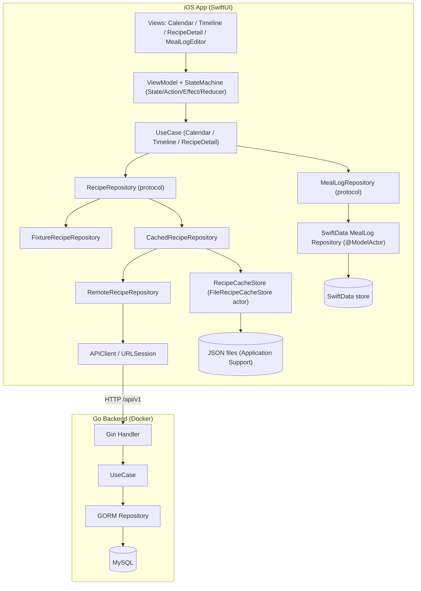
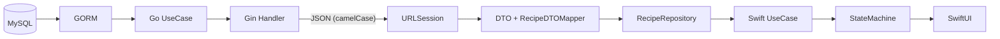
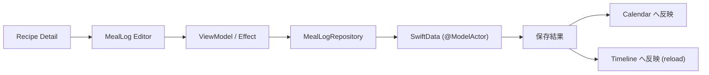
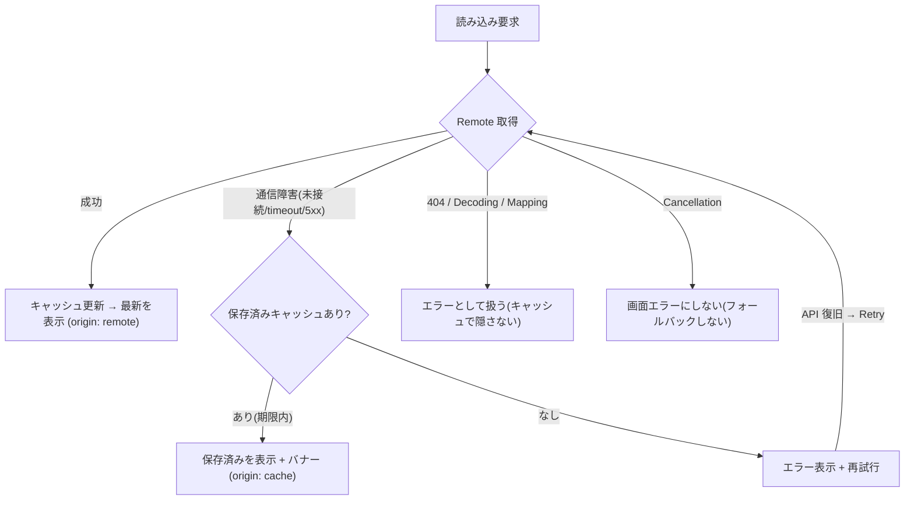

# Daily Recipe Calendar

カレンダーを起点にレシピを閲覧し、材料と調理手順を確認し、作った料理の記録を残して振り返るためのiOSアプリ。レシピはGo製API（MySQL）から取得し、オフライン閲覧用に端末側で永続キャッシュする。調理記録はSwiftDataによりローカル保存する。

SwiftUI、Swift 6 Concurrency、MVVM + StateMachine、SwiftData、Go（Gin/GORM）、MySQL、Dockerを扱う個人開発のポートフォリオ作品である。

Status: v1.0相当。ローカル実行・学習用途を想定しており、認証は実装していない。

## Overview

- Calendar: 日ごとの掲載レシピと調理記録をマーカーで一覧し、連続スクロールで前後の月を参照する。
- Recipe Detail: 写真を主役とするParallax HeroとCollapsing Headerで、材料と調理手順を提示する。
- Cooking Log: 作った料理を調理日・評価・メモ付きで保存する（SwiftData）。
- Timeline: 掲載レシピと調理履歴を日付別に俯瞰し、検索とフィルタで絞り込む。
- Remote + Offline: Go APIから取得したレシピを永続キャッシュし、通信障害時は取得日時付きで保存済みデータを表示する。
- Fixtureモード: バックエンドを起動しなくても同梱データで全画面が動作する（既定）。

## Features

- カレンダー上での掲載レシピ（🍴マーカー）と調理済み日の一覧表示
- レシピ詳細での材料・分量・手順の閲覧、写真メディア風のスクロール表現
- 評価（★）とメモ付きの調理記録、保存結果のCalendar / Timelineへの反映
- タイムラインでの検索と種別フィルタ（すべて／レシピ／作った記録）
- Go APIからのレシピ取得（Fixture / Remoteを起動時に選択）
- オフライン時の保存済みデータ表示と、復旧後の再取得
- アクセシビリティ対応（Dynamic Type、VoiceOver、Reduce Motion、Dark Mode）

## Screenshots

実機Simulator（iPhone 17 Pro）から取得した実アプリ画面である。

| Calendar | Timeline | Recipe Detail |
|---|---|---|
|  |  |  |

| MealLog Editor | Collapsing Header | Offline（保存済み表示） |
|---|---|---|
|  |  |  |

## Demo

デモ動画は未収録である。録画シナリオと手順は[docs/demo-recording-guide.md](docs/demo-recording-guide.md)に記載した。

## Tech Stack

| 領域 | 使用技術 |
|---|---|
| iOS言語 / UI | Swift 6（言語モードSwift 6）、SwiftUI、Observation |
| 並行性 / 永続化 | Swift Concurrency（async/await、actor）、SwiftData |
| テスト | Swift Testing、[swift-snapshot-testing](https://github.com/pointfreeco/swift-snapshot-testing)（テストターゲット限定） |
| その他iOS | 祝祭日判定に[CalculateCalendarLogic](https://github.com/fumiyasac/handMadeCalendarAdvance) |
| Backend | Go 1.23、Gin、GORM、MySQL 8.4 |
| Infra / Docs | Docker、Docker Compose、golang-migrate、Swagger 2.0、ADR |

iOS Deployment TargetはiOS 18.0以上。検証環境はXcode 26.5、Swift 6.3.2、iPhone 17 Pro Simulator。

## Architecture

アプリ本体（`App/`）と機能パッケージ（`AppFeature`）に分割したマルチモジュール構成を採る。PresentationはMVVM + StateMachine、データ取得はRepositoryパターンでFixture / Remote / Cacheを差し替える。MealLogは取得元に関わらずSwiftDataを使う。



取得元（Fixture / Remote）はComposition Rootの`CalendarFeatureDependencies`が起動時に1度だけ決定し、全画面で同一インスタンスを共有する。Debugでは環境変数`RECIPE_DATA_SOURCE`で選択でき、既定は`fixture`である。

## Data Flow

### Recipe取得（MySQLからSwiftUIまで）



### MealLog保存



### Offline Recovery（Network-first + Cacheフォールバック）



詳細は[ADR 0015](docs/adr/0015-offline-recipe-cache-and-recovery.md)を参照。

## Getting Started

### 前提

- macOS、Xcode 26.x、iOS 18以上のSimulator
- DockerおよびDocker Compose（Backend用。Goはコンテナ経由で実行するためホスト側にインストール不要）

### Fixtureモード（Backendなしで動かす最短手順）

1. `MediaStyleViewSwiftUI/App/MediaStyleViewSwiftUI.xcodeproj`をXcodeで開く。
2. Swift Package依存は自動解決される。
3. `MediaStyleViewSwiftUI`スキームとiPhone 17 Pro（iOS 18以上）を選択する。
4. Runする。既定はFixtureモードのため、ネットワーク接続なしでCalendar / Timeline / Recipe Detail / MealLog Editorが動作する。

### Backend（Docker Compose）

`backend/`ディレクトリで実行する。詳細は[backend/README.md](backend/README.md)を参照。

```bash
cd backend
cp .env.example .env             # 設定ファイルを作成する（.envはコミットしない）
make up                          # MySQLとGo APIを起動する
make migrate-up                  # Migrationを適用する
make seed                        # Seedデータ（レシピ）を投入する
curl -s http://localhost:8080/healthz           # ヘルスチェック
open http://localhost:8080/swagger/index.html   # Swagger UI
```

### iOSをRemoteモードで動かす

1. 上記でBackendを起動し、`http://localhost:8080`で待ち受けている状態にする。
2. XcodeのScheme → Run → Arguments → Environment Variablesに次を追加する。

   ```text
   RECIPE_DATA_SOURCE = remote
   ```

3. RunするとCalendar / Timeline / Recipe DetailがMySQL由来のデータを表示する。
4. 接続先は`APIConfiguration`で管理する（既定は`http://localhost:8080`）。Base URLをコードへ直接書かない方針を採る。ATSはグローバル無効化せず、`NSAllowsLocalNetworking`のみ許可している。

### Troubleshooting

| 症状 | 確認ポイント |
|---|---|
| Dockerが起動しない | Docker Desktopの状態、`docker compose ps`の出力 |
| MySQLへ接続できない | `make up`後にMySQLがhealthyになるまで待つ。`.env`の値を確認する |
| Migration未適用 | `make migrate-up`、`make migrate-version`で状態を確認する |
| Seedデータがない | `make seed`。API起動時には自動投入されない仕様である |
| Simulatorからlocalhostに繋がらない | SimulatorはMacのlocalhostに到達可能。実機はMacのLANアドレスを注入する |
| HTTP通信が失敗する | `App/.../Info.plist`の`NSAllowsLocalNetworking`を確認する |
| Remoteでデータが表示されない | `RECIPE_DATA_SOURCE=remote`とBackend起動を確認する。失敗時にFixtureへ自動切替はしない |
| キャッシュだけ表示される | 通信障害時の保存済み表示である。復旧後にRetry（再読み込み）で最新へ更新される |
| Swagger UIが開けない | `make up`後に`http://localhost:8080/swagger/index.html`を開く |

## Backend API

ベースパスは`/api/v1`。エラーレスポンスは`{"error":{"code","message"}}`形式を返す。Swagger定義（2.0）は`backend/docs/`に生成され、`http://localhost:8080/swagger/index.html`で閲覧できる。

| Method | Path | 概要 |
|---|---|---|
| GET | `/healthz` | Liveness |
| GET | `/readyz` | Readiness（DB接続確認） |
| GET | `/api/v1/recipes?limit&offset&category` | レシピ一覧（ページング） |
| GET | `/api/v1/recipes/{id}` | レシピ詳細（材料・手順） |
| GET | `/api/v1/calendar?from&to` | 期間の掲載割当（最大92日） |

## Testing

```bash
# iOS: 全テスト（Unit + Snapshot）
xcodebuild test -scheme AppFeature -destination 'platform=iOS Simulator,name=iPhone 17 Pro'

# iOS: 実APIへの結合テスト（オプトイン、Backend起動が前提）
TEST_RUNNER_RUN_REMOTE_INTEGRATION=1 xcodebuild test -scheme AppFeature \
  -destination 'platform=iOS Simulator,name=iPhone 17 Pro' \
  -only-testing:AppFeatureTests/CacheLiveIntegrationTests \
  -only-testing:AppFeatureTests/RemoteRecipeIntegrationTests

# Go: Docker経由（ホストにGo不要）
cd backend
make vet && make test && make test-race
make up && make migrate-up && make test-integration    # MySQL結合（テスト専用IDのみ使用）
```

UnitはSwift Testing、画面の視覚回帰はSnapshot Testingを使う（基準環境と更新手順は[ADR 0011](docs/adr/0011-visual-regression-snapshot-testing.md)に記載）。実APIに依存しないUnitテストはFake（HTTPClient / Repository）で実装している。最新の検証結果は[docs/verification-report.md](docs/verification-report.md)を参照。

## Design Decisions

設計判断はArchitecture Decision Record（`docs/adr/`）に記録している。主なものは次のとおり。

- MVVM + StateMachineへの統合: [0004](docs/adr/0004-integrate-calendar-feature-with-statemachine.md)
- SwiftDataをView層から隔離: [0003](docs/adr/0003-isolate-swiftdata-from-view-layer.md)
- レシピ中心のカレンダーとTimeline: [0008](docs/adr/0008-recipe-centric-calendar.md) / [0006](docs/adr/0006-recipe-meallog-timeline.md)
- メディア風Recipe DetailとZoom遷移: [0009](docs/adr/0009-recipe-detail-media-style-ui.md) / [0010](docs/adr/0010-recipe-zoom-navigation-transition.md)
- Snapshot Testing: [0011](docs/adr/0011-visual-regression-snapshot-testing.md)
- Go Backend API: [0012](docs/adr/0012-go-backend-recipe-calendar-api.md)
- Remote Repository境界と画面統合: [0013](docs/adr/0013-swift-remote-repository-go-backend-api-boundary.md) / [0014](docs/adr/0014-remote-recipe-integration-calendar-timeline-detail.md)
- オフラインキャッシュと復旧: [0015](docs/adr/0015-offline-recipe-cache-and-recovery.md)

技術的な要点は次のとおり。

- StateMachine: Reducerは純粋関数、非同期I/OはEffect / ViewModelに分離する。requestIDで古い結果を破棄し、月単位のキャッシュで連続スクロールの破綻を避ける。
- Swift 6 Concurrency: ViewModelは`@MainActor`、DomainとStateはSendable、SwiftData Repositoryは`@ModelActor`とする。Task Cancellationを適切に扱い、`@unchecked Sendable`は使わない。
- Repositoryパターン: Fixture / Remote / Cacheを同一Protocolで差し替える。DTOとDomainをMapperで分離する。
- Offline: Network-first + Cacheフォールバック方式を採る。Fresh / Stale / Expiredによる鮮度管理、通信失敗とデータ0件の区別、Cancellationをフォールバックのトリガーにしない設計を徹底する。

## Project Development History

機能単位で段階的に開発した。主な節目は次のとおり。

- Recipe DomainとFixture、Calendar + StateMachine、Recipe DetailとMealLog Editor、Timelineの実装
- メディア風Recipe Detail、Zoom Navigation、Snapshot Testingの導入
- Go Backend（Gin / GORM / MySQL / Docker / Swagger）、Swift Remote Repository、Calendar / Timeline / DetailのRemote統合
- 永続オフラインキャッシュと通信障害からの復旧
- v1.0ショーケース整備

## Limitations

- 認証と認可は未実装である。ローカル開発用途を前提とし、MySQLはホストに公開しない構成を採る。
- レシピの作成および編集APIは提供しない（読み取り専用）。MealLogのRemote同期も未対応で、ローカルSwiftDataのみを使う。
- 画像は同梱Asset（Recipe ID由来）で解決する。Remote画像配信や独自のダウンロード基盤は実装していない。
- CI（GitHub Actions等）は未整備である。
- 既知のSnapshot失敗が1件存在する（MealLog Editor入力フォームの基準画像ドリフト）。詳細は[verification-report](docs/verification-report.md)を参照。
- 同梱レシピ写真のライセンスは未確認である。再配布前の確認が必要である（[LICENSE](LICENSE)を参照）。

## Future Work

- オフラインの二段階表示（cache-first表示 → バックグラウンド再取得）とネットワーク復旧検知によるRetryヒント
- MealLogのRemote同期、アカウント連携、認証
- レシピの作成および編集、画像アップロードとCDN配信
- CI（ビルド、テスト、Lint）の整備

## License

[MIT](LICENSE)。同梱レシピ画像は対象外のため、再配布前にライセンスを確認する必要がある。
