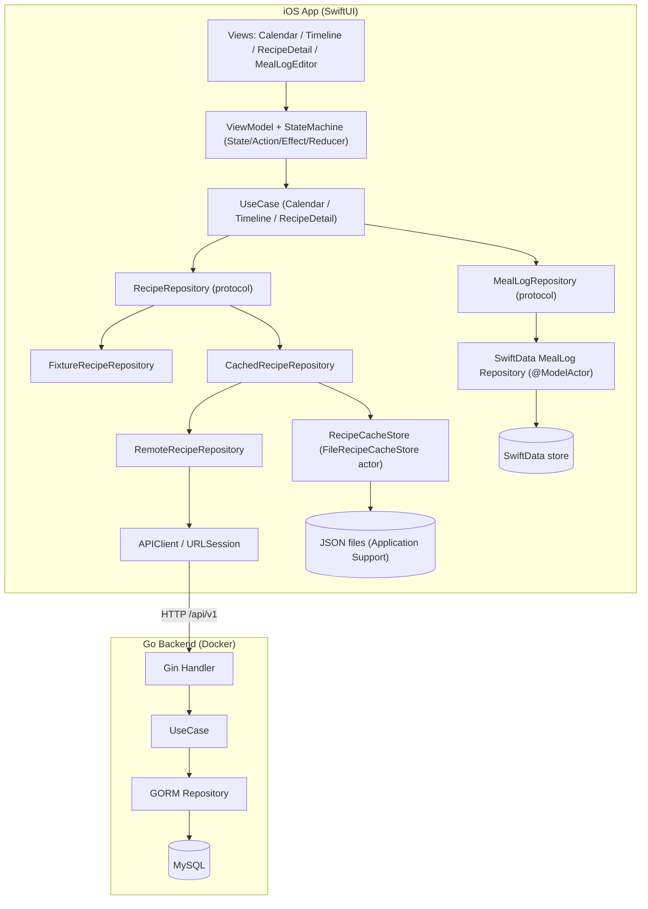
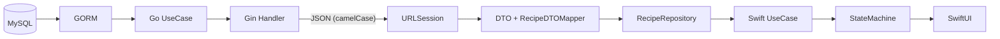
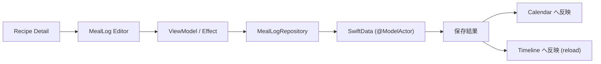
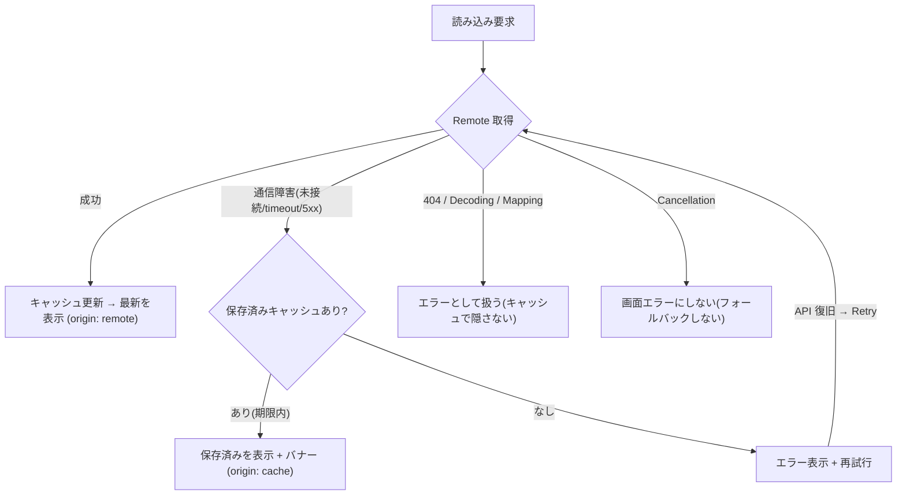

# Daily Recipe Calendar

カレンダーを起点にレシピを見つけ、材料と調理手順を確認し、作った料理を記録して振り返る iOS アプリです。
レシピは Go 製 API（MySQL）から取得し、オフライン用に永続キャッシュを備え、調理記録は SwiftData にローカル保存します。

SwiftUI / Swift 6 Concurrency / MVVM + StateMachine / SwiftData / Go(Gin, GORM) / MySQL / Docker を一貫して扱う
個人開発のポートフォリオ作品です。

> Status: v1.0 相当（ローカル実行・学習用途）。認証は未実装で、ローカル開発向けの構成です。

## Overview

- **Calendar**: 日ごとの掲載レシピと自分の調理記録をマーカーで表示。前後の月を連続スクロールできます。
- **Recipe Detail**: 写真を主役にした Parallax Hero と Collapsing Header で、材料・調理手順を閲覧。
- **Cooking Log**: 「作った記録」を調理日・評価・メモ付きで保存（SwiftData）。
- **Timeline**: 掲載レシピと調理履歴を日付別に振り返り、検索・フィルタで絞り込み。
- **Remote + Offline**: レシピは Go API（MySQL）から取得。通信できないときは保存済みキャッシュを表示し、
  取得日時と鮮度を提示します。
- **Fixture モード**: Backend なしでも同梱データで全画面を動かせます（既定）。

## Features

- カレンダー上で掲載レシピ（🍴マーカー）と調理済み日を一目で把握
- レシピ詳細で材料・分量・手順を確認、写真メディア風のスクロール表現
- 「作った記録」を評価（★）とメモ付きで保存し、カレンダー／タイムラインへ反映
- タイムラインでの検索・種別フィルタ（すべて／レシピ／作った記録）
- Go API からのレシピ取得（Fixture / Remote を起動時に切り替え）
- オフライン時の保存済みデータ表示と、通信復旧後の再取得（Retry）
- アクセシビリティ配慮（Dynamic Type / VoiceOver / Reduce Motion / Dark Mode）

## Screenshots

すべて実機 Simulator（iPhone 17 Pro）から取得した実際のアプリ画面です。

| Calendar | Timeline | Recipe Detail |
|---|---|---|
|  |  |  |

| MealLog Editor | Collapsing Header | Offline（保存済み表示） |
|---|---|---|
|  |  |  |

## Demo

デモ動画は現時点では未収録です。録画シナリオと手順は [docs/demo-recording-guide.md](docs/demo-recording-guide.md) に記載しています。

## Tech Stack

| 領域 | 使用技術 |
|---|---|
| iOS 言語 / UI | Swift 6（言語モード Swift 6）/ SwiftUI / Observation |
| 並行性 / 永続化 | Swift Concurrency（async/await, actor）/ SwiftData |
| テスト | Swift Testing / [swift-snapshot-testing](https://github.com/pointfreeco/swift-snapshot-testing)（テスト専用） |
| その他 iOS | 祝祭日判定に [CalculateCalendarLogic](https://github.com/fumiyasac/handMadeCalendarAdvance) |
| Backend | Go 1.23 / Gin / GORM / MySQL 8.4 |
| Infra / Docs | Docker / Docker Compose / golang-migrate / Swagger(2.0) / ADR |

- iOS Deployment Target: iOS 18.0 以上
- 検証環境: Xcode 26.5 / Swift 6.3.2 / iPhone 17 Pro Simulator

## Architecture

マルチモジュール構成（アプリ本体 `App/` + 機能パッケージ `AppFeature`）。Presentation は MVVM + StateMachine、
データ取得は Repository パターンで Fixture / Remote / Cache を差し替えます。MealLog は取得元に関わらず SwiftData です。



取得元（Fixture / Remote）は Composition Root（`CalendarFeatureDependencies`）が起動時に 1 度だけ決め、
全画面で同一インスタンスを共有します（Debug は環境変数 `RECIPE_DATA_SOURCE` で選択、既定は `fixture`）。

## Data Flow

### Recipe 取得（MySQL → SwiftUI）



### MealLog 保存（SwiftData）



### Offline Recovery（Network-first + Cache フォールバック）



詳細は [ADR 0015](docs/adr/0015-offline-recipe-cache-and-recovery.md) を参照。

## Getting Started

### 前提

- macOS / Xcode 26.x / iOS 18+ Simulator
- Docker / Docker Compose（Backend 用。Go はコンテナ経由で実行するためホストに Go は不要）

### Fixture モード（Backend 不要・最短）

1. `MediaStyleViewSwiftUI/App/MediaStyleViewSwiftUI.xcodeproj` を Xcode で開く。
2. Swift Package 依存は自動解決される。
3. `MediaStyleViewSwiftUI` スキーム + iPhone 17 Pro（iOS 18+）を選択。
4. Run。既定は Fixture モードのため、ネットワークなしで Calendar / Timeline / Recipe Detail / MealLog が動作します。

### Backend（Docker Compose）

`backend/` で実行します。詳細は [backend/README.md](backend/README.md) を参照。

```bash
cd backend
cp .env.example .env          # 設定ファイルを作成（.env はコミットしない）
make up                       # MySQL + Go API を起動
make migrate-up               # Migration を適用
make seed                     # Seed データ（レシピ）を投入
curl -s http://localhost:8080/healthz    # ヘルスチェック（200）
open http://localhost:8080/swagger/index.html   # Swagger UI
```

### iOS を Remote モードで動かす

1. 上記で Backend を起動（`http://localhost:8080` で待受）。
2. Xcode の Scheme → Run → Arguments → Environment Variables に以下を追加：

   ```text
   RECIPE_DATA_SOURCE = remote
   ```

3. Run。Calendar / Timeline / Recipe Detail が MySQL 由来のデータを表示します。
4. 接続先は `APIConfiguration`（既定 `http://localhost:8080`）。Base URL はコードに直書きしません。
   ATS はグローバル無効化せず `NSAllowsLocalNetworking`（ローカル宛てのみ）を許可しています。

### Troubleshooting

| 症状 | 確認ポイント |
|---|---|
| Docker が起動しない | Docker Desktop の起動、`docker compose ps` の状態 |
| MySQL へ接続できない | `make up` 後に MySQL が healthy になるまで待つ。`.env` の値 |
| Migration 未適用 | `make migrate-up`、`make migrate-version` で状態確認 |
| Seed データがない | `make seed`（API 起動時には自動投入されない設計） |
| Simulator から localhost に繋がらない | Simulator は Mac の `localhost` に到達可能。実機は Mac の LAN アドレスを注入 |
| HTTP 通信が失敗（ATS） | `App/.../Info.plist` の `NSAllowsLocalNetworking` を確認 |
| Remote でデータが出ない | `RECIPE_DATA_SOURCE=remote` と Backend 起動を確認。失敗時は Fixture へ自動切替しません |
| キャッシュだけ表示される | 通信障害時の保存済み表示です。復旧後に Retry（再読み込み）で最新へ更新 |
| Swagger UI が開けない | `make up` 後に `http://localhost:8080/swagger/index.html` |

## Backend API

ベースパス `/api/v1`。エラーは `{"error":{"code","message"}}` 形式。Swagger 定義（2.0）は `backend/docs/` に生成され、
`http://localhost:8080/swagger/index.html` で閲覧できます。

| Method | Path | 概要 |
|---|---|---|
| GET | `/healthz` | Liveness |
| GET | `/readyz` | Readiness（DB 接続確認） |
| GET | `/api/v1/recipes?limit&offset&category` | レシピ一覧（ページング） |
| GET | `/api/v1/recipes/{id}` | レシピ詳細（材料・手順） |
| GET | `/api/v1/calendar?from&to` | 期間の掲載割当（最大 92 日） |

## Testing

```bash
# iOS: 全テスト（Unit + Snapshot）
xcodebuild test -scheme AppFeature -destination 'platform=iOS Simulator,name=iPhone 17 Pro'

# iOS: 実 API への結合（オプトイン。Backend 起動が前提）
TEST_RUNNER_RUN_REMOTE_INTEGRATION=1 xcodebuild test -scheme AppFeature \
  -destination 'platform=iOS Simulator,name=iPhone 17 Pro' \
  -only-testing:AppFeatureTests/CacheLiveIntegrationTests \
  -only-testing:AppFeatureTests/RemoteRecipeIntegrationTests

# Go: Docker 経由（ホストに Go 不要）
cd backend
make vet && make test && make test-race
make up && make migrate-up && make test-integration   # MySQL 結合（テスト専用 ID のみ使用）
```

- Unit は Swift Testing、画面の視覚回帰は Snapshot Testing（基準環境・更新手順は
  [ADR 0011](docs/adr/0011-visual-regression-snapshot-testing.md)）。
- 実 API に依存しない Unit は Fake（HTTPClient / Repository）を使用。
- 最新の検証結果は [docs/verification-report.md](docs/verification-report.md) を参照。

## Design Decisions

設計判断は ADR（Architecture Decision Record）に記録しています（`docs/adr/`）。主なもの:

- MVVM + StateMachine への統合: [0004](docs/adr/0004-integrate-calendar-feature-with-statemachine.md)
- SwiftData を View 層から隔離: [0003](docs/adr/0003-isolate-swiftdata-from-view-layer.md)
- レシピ中心のカレンダー / Timeline: [0008](docs/adr/0008-recipe-centric-calendar.md) / [0006](docs/adr/0006-recipe-meallog-timeline.md)
- メディア風 Recipe Detail / Zoom 遷移: [0009](docs/adr/0009-recipe-detail-media-style-ui.md) / [0010](docs/adr/0010-recipe-zoom-navigation-transition.md)
- Snapshot Testing: [0011](docs/adr/0011-visual-regression-snapshot-testing.md)
- Go Backend API: [0012](docs/adr/0012-go-backend-recipe-calendar-api.md)
- Remote Repository 境界 / 画面統合: [0013](docs/adr/0013-swift-remote-repository-go-backend-api-boundary.md) / [0014](docs/adr/0014-remote-recipe-integration-calendar-timeline-detail.md)
- オフラインキャッシュと復旧: [0015](docs/adr/0015-offline-recipe-cache-and-recovery.md)

技術的な要点:

- **StateMachine**: Reducer は純粋関数、非同期 I/O は Effect / ViewModel に分離。requestID で古い結果を破棄し、
  月単位のキャッシュで連続スクロールを破綻させない。
- **Swift 6 Concurrency**: `@MainActor` ViewModel、Sendable な Domain / State、`@ModelActor` の SwiftData Repository、
  Task Cancellation の適切な扱い（`@unchecked Sendable` 等は不使用）。
- **Repository パターン**: Fixture / Remote / Cache を同一 Protocol で差し替え。DTO↔Domain を Mapper で分離。
- **Offline**: Network-first + Cache フォールバック。鮮度（Fresh/Stale/Expired）管理、通信失敗とデータ 0 件の区別、
  Cancellation をフォールバックのトリガーにしない。

## Project Development History

機能単位で段階的に開発しました（抜粋）:

- Recipe Domain / Fixture、Calendar + StateMachine、Recipe Detail + MealLog Editor、Timeline
- メディア風 Recipe Detail、Zoom Navigation、Snapshot Testing 導入
- Go Backend（Gin/GORM/MySQL/Docker/Swagger）、Swift Remote Repository、Calendar/Timeline/Detail の Remote 統合
- 永続オフラインキャッシュと通信障害からの復旧
- v1.0 ショーケース整備（本 PR）

## Limitations

- 認証・認可は未実装（ローカル開発用途。MySQL はホストに公開しない構成）。
- レシピの作成・編集 API はなし（読み取り専用）。MealLog の Remote 同期はなし（ローカル SwiftData のみ）。
- 画像は同梱 Asset（ID 由来）で、Remote 画像配信／独自ダウンロード基盤は未実装。
- CI（GitHub Actions 等）は未整備。
- Snapshot の 1 件（MealLog Editor 入力フォーム）が基準画像ドリフトで失敗する既知事象あり
  （[verification-report](docs/verification-report.md) 参照）。
- 同梱レシピ写真のライセンスは未確認（再配布前に要確認。[LICENSE](LICENSE) 参照）。

## Future Work

- オフラインの二段階表示（cache-first → バックground 再取得）、ネットワーク復旧検知による Retry ヒント
- MealLog の Remote 同期・アカウント連携・認証
- レシピ作成／編集、画像アップロード・CDN 配信
- CI（ビルド・テスト・Lint）の整備

## License

[MIT](LICENSE)（同梱レシピ画像は対象外。再配布前にライセンス要確認）。
